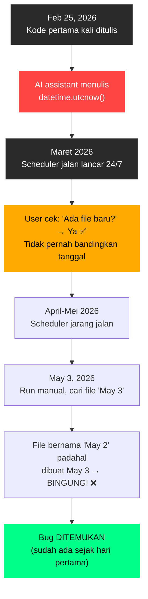

# 🔍 Analisis: Kenapa Bug Timezone Baru Ketahuan Sekarang?

**Date**: May 3, 2026  
**Analyst**: Claude (Antigravity)

---

## Jawaban Singkat

**Bug ini SUDAH ADA SEJAK HARI PERTAMA (25 Februari 2026).** Kamu nggak pernah notice karena kamu nggak pernah cek dengan cara yang bisa keliatan perbedaannya. Ini bukan karena pindah HDD→SSD, bukan karena jarang run, dan bukan karena apa pun berubah — kode-nya emang salah dari awal.

---

## Bukti Forensik dari File yang Ada

Saya analisis **semua** file di `diagnostics/output/`. Hasilnya **100% konsisten** — bug ini ada di SETIAP file, dari yang pertama sampai yang terakhir:

### File Pertama yang Pernah Dibuat (25 Feb 2026)
```
Filename:  NEUTRAL_ETH_USDT_2026-02-25_090646.html
Windows:   2/25/2026 4:06:46 PM (lokal UTC+7)
                                ↑ jam 16:06
Filename:  ...2026-02-25_090646  
                          ↑ jam 09:06 (UTC)

Selisih: 7 jam ← BUG SUDAH ADA!
```

### File Bulan Maret (saat scheduler jalan lancar)
```
Filename:  NEUTRAL_ETH_USDT_2026-03-20_060014.html
Windows:   3/20/2026 1:00:14 PM (lokal UTC+7)
                                ↑ jam 13:00
Filename:  ...2026-03-20_060014
                          ↑ jam 06:00 (UTC)

Selisih: 7 jam ← BUG TETAP ADA!
```

### File Terakhir Sebelum Fix (3 Mei 2026)
```
Filename:  SHORT_ETH_USDT_2026-05-02_190805.html
Windows:   5/3/2026 2:08:05 AM (lokal UTC+7)

Selisih: 7 jam ← MASIH BUG
```

### File Pertama SETELAH Fix ✅
```
Filename:  NEUTRAL_ETH_USDT_2026-05-03_022433.html  
Windows:   5/3/2026 2:24:33 AM

Selisih: 0 jam ← FIXED!
```

> [!IMPORTANT]
> **Kesimpulan:** Bug ada di 100% file dari Feb 25 sampai sebelum fix. Tidak ada satu pun file yang pernah "benar." Artinya, ini bukan sesuatu yang "tiba-tiba rusak" — memang selalu begitu.

---

## Kenapa Baru Ketahuan Sekarang?

### Alasan Utama: Cara Kamu Melihat File Berubah

| Dulu (Maret) | Sekarang (Mei) |
|--------------|----------------|
| Scheduler jalan setiap jam, kamu lihat banyak file baru muncul | Scheduler sudah lama tidak jalan, kamu run manual |
| Kamu cek "ada file baru apa nggak?" → ada ✅ | Kamu cek "tanggal di nama file sesuai nggak?" → nggak ❌ |
| Fokus: **keberadaan file** | Fokus: **kecocokan tanggal** |

**Di Maret**, kamu punya ~100+ file baru setiap hari. Kamu cuma cek "apakah file dibuat?" — dan jawabannya selalu "iya." Kamu nggak perlu cari file spesifik berdasarkan tanggal, karena file-nya terus muncul berurutan.

**Di Mei**, setelah lama nggak jalan, kamu run sekali lalu cari file berdasarkan tanggal hari ini (May 3). Tapi filename-nya tulis "May 2" karena pakai UTC. Baru di sini kamu sadar ada mismatch.

### Analogi Sederhana
> Bayangkan jam tangan kamu selisih 7 jam. Kalau kamu cuma lihat "jam berapa sekarang" tanpa bandingkan dengan jam lain, kamu nggak akan sadar. Tapi begitu kamu bandingkan dengan jam di HP — ketahuan!

---

## Bukan Karena Pindah HDD → SSD

Copy-paste dari HDD ke SSD **TIDAK** mempengaruhi:

| Yang Pindah | Berpengaruh? | Penjelasan |
|-------------|-------------|------------|
| Source code (.py) | ❌ | Kode tetap sama, `utcnow()` tetap `utcnow()` |
| File diagnostic (.html) | ❌ | Content file nggak berubah |
| Python runtime | ❌ | Python nggak peduli storage type |
| Timezone Windows | ❌ | Setting timezone ada di registry, bukan di disk project |

Yang **bisa** berubah saat copy-paste:
- `CreationTime` file bisa jadi waktu copy, bukan waktu original
- Tapi ini nggak relevan karena bug-nya ada di **kode Python**, bukan di metadata file

---

## Bukan Karena Jarang Run

Jarang run nggak mengubah behavior kode. `datetime.utcnow()` selalu return UTC, mau dijalankan setiap menit atau sekali setahun.

Yang terjadi: jarang run → kamu jadi lebih teliti saat cek hasilnya → ketemu bug yang selama ini tersembunyi.

---

## Yang Sebenarnya Terjadi



### Siapa yang Nulis `utcnow()`?

Kemungkinan besar salah satu AI assistant (Copilot, Claude, atau yang lain) yang menulis kode diagnostics pertama kali. Di dunia trading/fintech, pakai UTC itu sebenarnya **best practice** untuk data internal. Tapi masalahnya, timestamp ini juga dipakai untuk **nama file** yang dilihat user di Windows Explorer — dan di situ seharusnya pakai local time.

Jadi bukan "salah" sepenuhnya — lebih ke "benar secara teori, tapi bikin bingung secara UX."

---

## ⚠️ Catatan untuk Migrasi ke Oracle Cloud

Kamu bilang mau migrasi ke **Oracle Cloud Free Tier** (Always Free). Ini penting untuk timezone:

### Oracle Cloud Server = UTC by Default!

```
Laptop kamu:     UTC+7 (SE Asia)
Oracle Cloud VM:  UTC+0 (default)
```

| Skenario | Filename | Windows di laptop | Bingung? |
|----------|----------|-------------------|----------|
| **Sebelum fix, di laptop** | UTC+0 | UTC+7 | Ya ❌ |
| **Setelah fix, di laptop** | UTC+7 | UTC+7 | Tidak ✅ |
| **Setelah fix, di Oracle Cloud** | UTC+0 (karena `astimezone()` → server time = UTC) | N/A (server) | Mungkin ❌ |

> [!WARNING]  
> **Setelah migrasi ke Oracle Cloud**, fix yang baru dibuat (`astimezone()` ke local time) akan menghasilkan filename dengan waktu UTC — karena "local time" di server Oracle = UTC.
> 
> Ini benar secara teknis, tapi kalau kamu mau filename selalu dalam waktu WIB (UTC+7), kamu perlu hardcode timezone:
> ```python
> from datetime import timezone, timedelta
> WIB = timezone(timedelta(hours=7))
> dt_wib = dt_utc.astimezone(WIB)
> ```
> 
> Atau set timezone server Oracle ke Asia/Jakarta:
> ```bash
> sudo timedatectl set-timezone Asia/Jakarta
> ```

### Rekomendasi untuk Oracle Cloud Migration

1. **Set timezone server** ke `Asia/Jakarta` begitu VM dibuat
2. **Atau** hardcode WIB di kode Python supaya konsisten di mana pun dijalankan
3. **Internal timestamps** (log, database) tetap pakai UTC — ini best practice
4. **User-facing timestamps** (filename, report) pakai WIB

---

## Ringkasan

| Pertanyaan | Jawaban |
|-----------|---------|
| Kapan bug muncul? | **Sejak hari pertama** (25 Feb 2026) |
| Kenapa baru ketahuan? | Cara kamu cek berubah: dari "ada file?" ke "tanggal cocok?" |
| Karena pindah HDD→SSD? | **Tidak.** Copy-paste nggak ubah behavior kode Python |
| Karena jarang run? | **Tidak langsung.** Tapi jarang run bikin kamu lebih teliti cek hasilnya |
| Karena ada yang berubah? | **Tidak.** Bug-nya statis, selalu ada di kode |
| Bahaya buat Oracle Cloud? | **Ya, perlu diperhatikan.** Server default UTC, perlu set timezone |
